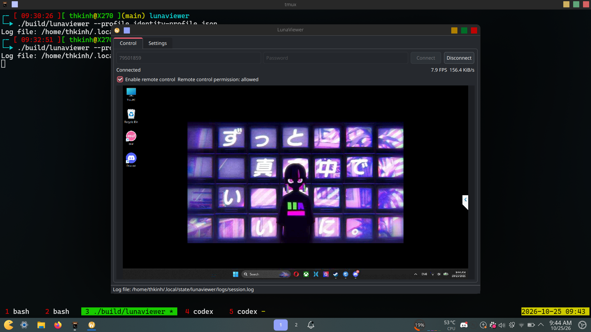

# LunaViewer

LunaViewer is an experimental **UltraViewer client for Linux**. It connects to and controls authorized Windows computers running UltraViewer; it does not let you host a session from Linux or control Linux computers.

This is my first project built with OpenAI Codex. I used Codex and multiple coding agents to research the protocol, using the MacViewer project as a reference, and build this Linux client.

The current version has been used to view a Windows screen and send mouse and keyboard input. It is still a test project, not a production replacement for UltraViewer. Keyboard input requires a Windows peer running UltraViewer 6.2.13 or newer.



## Build from source

Requirements: C++17 compiler, CMake 3.20 or newer, Qt 6 Core/Network/Widgets, OpenSSL, Zstandard, and libjpeg-turbo with its TurboJPEG API.

On Arch Linux:

```sh
sudo pacman -S --needed base-devel cmake pkgconf qt6-base openssl zstd libjpeg-turbo
```

On Ubuntu/Debian:

```sh
sudo apt install build-essential cmake pkg-config qt6-base-dev libssl-dev libzstd-dev libturbojpeg0-dev
```

From the LunaViewer source directory, configure, build, and run the offline tests:

```sh
cmake -S . -B build -DCMAKE_BUILD_TYPE=Release -DCMAKE_EXPORT_COMPILE_COMMANDS=ON
cmake --build build -j"$(nproc)"
ctest --test-dir build --output-on-failure
```

The tests use local fixtures and do not connect to UltraViewer services.

## First-time setup and run

1. Create a private identity profile. Run this once from the LunaViewer source directory:

   ```sh
   python3 tools/create_identity_profile.py
   ```

   The script detects the default IPv4 route and creates `identity-profile.json` with mode `0600`. It names this client `LunaViewer-<hostname>` in the Windows client log (the protocol limits that name to 20 characters). It does not contact any server and refuses to overwrite an existing profile. Keep this file for future runs; it contains this installation's local registration identity. If you use a VPN or several network interfaces, choose one explicitly:

   ```sh
   python3 tools/create_identity_profile.py --interface enp3s0 --local-ip 192.168.1.20
   ```

2. LunaViewer includes `8bit.dat`, the Zstandard dictionary required to decode screen updates. Its provenance and checksum are recorded in [8BIT-DATA-NOTICE.txt](8BIT-DATA-NOTICE.txt).

3. Start LunaViewer from the LunaViewer source directory. The generated profile already points to the bundled dictionary:

   ```sh
   ./build/lunaviewer --profile identity-profile.json
   ```

4. Enter the Windows computer's UltraViewer ID and password. Connect, then enable **Enable remote control** when the host permits control. The Windows peer's password is entered in the app; it is not stored in the local identity profile.

On a Wayland desktop, if Qt reports that the XCB platform cannot connect to the display, try launching with `QT_QPA_PLATFORM=wayland` before the command above.

## Screen settings and performance

Open the **Settings** tab while connected to change remote image quality or toggle **Render background wallpaper**. The quality presets are Speed (30), Automatic (45, the default), and Quality (70); LunaViewer sends these choices to the Windows peer, which determines the resulting image and bandwidth. Wallpaper and quality preferences are saved for future launches.

The **Control** tab shows live decoded FPS and compressed screen data rate in KiB/s beside the connection status. The **Settings** tab also reports average local decode time and remote canvas dimensions. These measurements help distinguish host/network limits from local decoding cost; payload rate excludes transport overhead.

## Logs

The app shows the log path in its status bar. By default it is `${XDG_STATE_HOME:-~/.local/state}/lunaviewer/logs/session.log`. To choose another directory, add `--log-dir /path/to/logs`. Logs contain connection and protocol diagnostics, but not credentials, typed text, key codes, or screen payloads.

## Scope and attribution

LunaViewer currently implements the Linux viewer/controller side for Windows peers. Linux hosting, file transfer, clipboard, chat, audio, LAN upgrades, and older screen/input variants are not implemented.

Protocol behavior is based on the MacViewer source snapshot and local reverse-engineering notes. See [MACVIEWER-LICENSE.txt](MACVIEWER-LICENSE.txt), [THIRD_PARTY_NOTICES.md](THIRD_PARTY_NOTICES.md), and [8BIT-DATA-NOTICE.txt](8BIT-DATA-NOTICE.txt) for attribution and asset notices.

Cám ơn anh Tâm Nguyễn đã share bài trên J2TEAM Community
